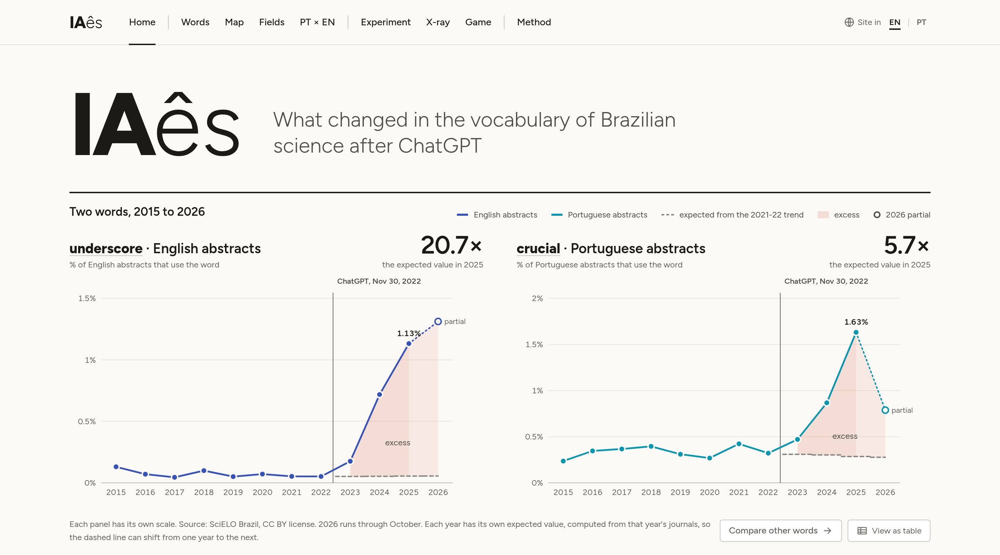

# Is AI delving into Brazilian science?

This repository holds a study of the vocabulary of Brazilian scientific abstracts before and after
ChatGPT, and IAês, an interactive site built on the same data. The question is whether LLM chatbots
left a measurable trace in the abstracts of SciELO Brazil, and whether that trace is larger in the
English abstract than in the Portuguese abstract of the same paper.

[](https://arthursudbrackibarra.github.io/Trab-BIIAP/)

The site is at https://arthursudbrackibarra.github.io/Trab-BIIAP/ in English, with a Portuguese
version at [/pt/](https://arthursudbrackibarra.github.io/Trab-BIIAP/pt/). It runs in the browser on
precomputed data. It sets no cookies and makes no requests to other sites.

## Data and method

The corpus has the abstracts that the journals of SciELO Brazil deposit with Crossref, from 2015 to
2026 (2026 runs through October): 204,937 usable abstracts from 357 of the 427 journals, of which
94,882 are in Portuguese, 100,718 in English and 9,337 in Spanish. A sample of 15,600 papers drawn
through SciELO's ArticleMeta API gives 9,312 papers with both a Portuguese and an English abstract.

The analysis follows the excess vocabulary method of Kobak et al. (2025). For each word, the share
of abstracts that use it is compared with the value expected from its 2021-22 trend. Style words
that rose far above that line are the marker words; words that grew because their subject grew,
like covid, do not count. The corpus is about a hundred times smaller than PubMed, so we added a
balanced panel of journals, length standardization, significance tests and a cross-fitted lower
bound. The Method page of the site explains each change.

## Findings

- From 2018 to 2022, at most 6 style words a year rose above the trend in each language. In 2025
  there were 108 in English abstracts and 69 in Portuguese abstracts.
- At least 17.3% of the English abstracts and 12.7% of the Portuguese abstracts published in 2025
  went through an LLM. This is a lower bound, since it only counts texts in which the model left
  marker words.
- In the same papers, the share of abstracts with a marker word rose 17.5 points in English and
  14.9 in Portuguese from 2021-22 to 2025-26. That difference is about the size of the placebo.
  English rose clearly faster only in 2024.
- Most Portuguese marker words mirror English ones (aprofunda and delves, for example): 72% of them
  translate into an English marker, against 44% of control words.
- When ChatGPT and Gemini polished English abstracts published from 2019 to 2021, they added about 5
  marker words per abstract. Claude added about 1.

## Repository

| Folder | Contents |
|---|---|
| `scripts/` | Data collection, the excess vocabulary analysis, the cross-language and same-paper tests, the rewriting experiment and the site data |
| `analysis/` | Reports and tables produced by the scripts |
| `experiment/` | Prompts, batches and the replies of ChatGPT, Gemini and Claude |
| `site/` | The IAês site: page generator, templates, texts in both languages, scripts and data |
| `Artigo/` | The paper (`paper.tex`), its figures and references, in the SBC LaTeX template |
| `docs/` | Project notes, the paper plan and the AI usage log |

## Reproducing

Everything runs on the Python 3 standard library. The raw data is not in the repository: the
collection step downloads it again from the public APIs and resumes where it stopped.

```
# collection
python3 -I scripts/harvest_scielo.py journals
python3 -I scripts/harvest_scielo.py crossref
python3 -I scripts/harvest_scielo.py pairs

# excess vocabulary, labels and lower bound
python3 -I scripts/excess.py prepare
python3 -I scripts/excess.py audit
python3 -I scripts/excess.py excess --rule rolling
python3 -I scripts/excess.py excess --rule fixed
python3 -I scripts/excess.py excess --rule fixed --half a
python3 -I scripts/excess.py excess --rule fixed --half b
python3 -I scripts/excess.py label
python3 -I scripts/excess.py report

# marker words in both languages
python3 -I scripts/crosslang.py controls
python3 -I scripts/crosslang.py translate
python3 -I scripts/crosslang.py compare

# rewriting experiment
python3 -I scripts/experiment.py ingest
python3 -I scripts/experiment.py analyze

# the same paper in two languages
python3 -I scripts/pairs.py prepare
python3 -I scripts/pairs.py compare

# site, served at http://localhost:8000/
python3 -I scripts/build_site_data.py all
python3 -I site/build.py
python3 -m http.server 8000 -d site/dist

# paper, written to Artigo/build/paper.pdf (needs a TeX distribution)
cd Artigo && latexmk paper.tex
```

The steps that call Claude (`label`, `controls` and `translate`) need Claude Code; the labels and
translations we used are in the repository. The workflow in `.github/workflows/pages.yml` publishes
the site on GitHub Pages.

## Authors

Arthur Sudbrack Ibarra, Rodrigo Coelho Barros and Lucas Silveira Kupssinskü, Programa de
Pós-Graduação em Ciência da Computação (PPGCC), Pontifícia Universidade Católica do Rio Grande do
Sul (PUCRS). Term paper for the course Benefícios e Impactos da Inteligência Artificial na Pesquisa
(BIIAP), 2026/2.

The abstracts come from SciELO Brazil under a CC BY license. The method is from Kobak,
González-Márquez, Horvát and Lause, "Delving into LLM-assisted writing in biomedical publications
through excess vocabulary", Science Advances 11(27), 2025, doi:10.1126/sciadv.adt3813.
